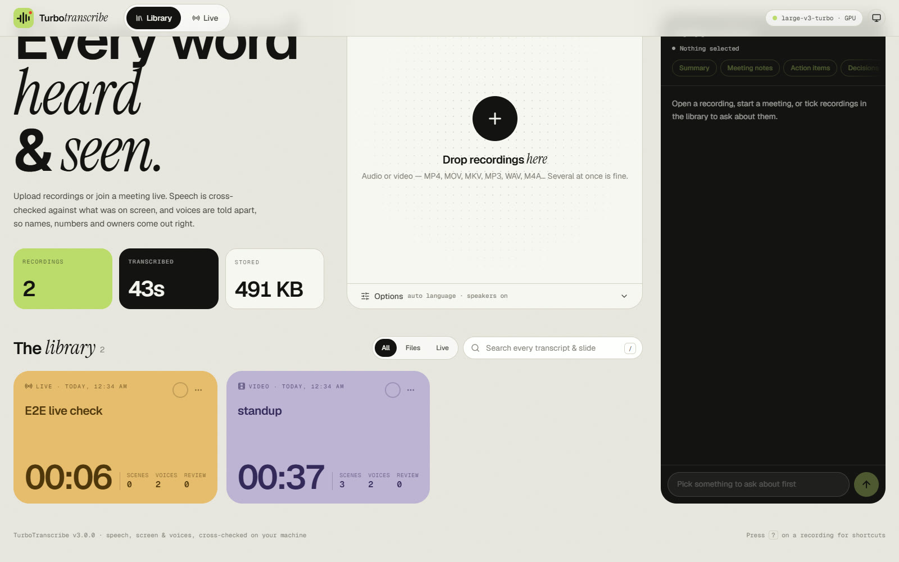
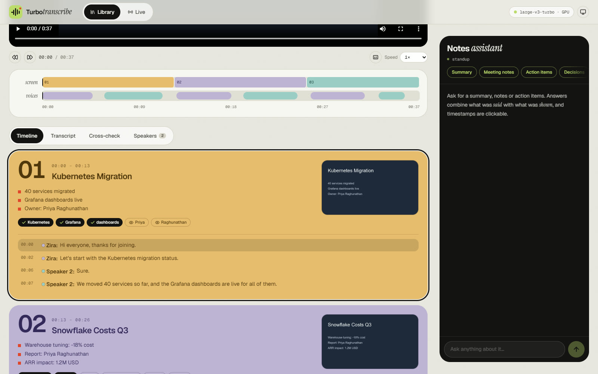
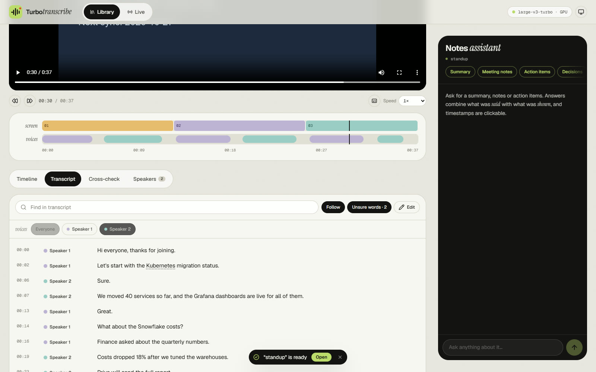
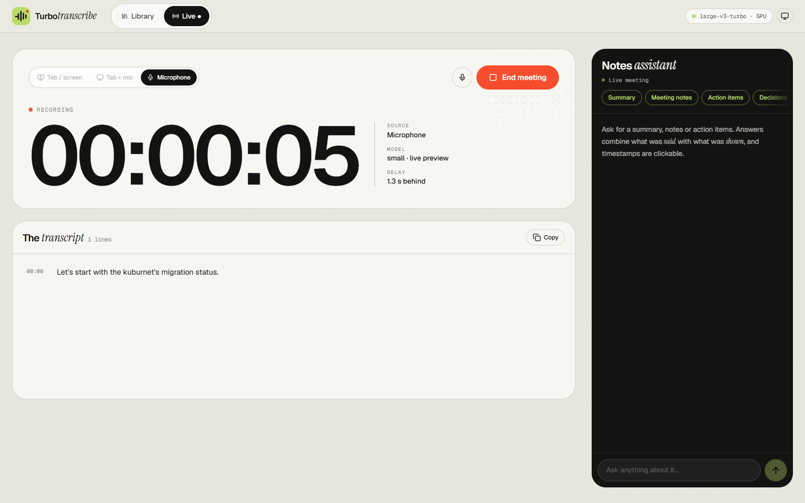
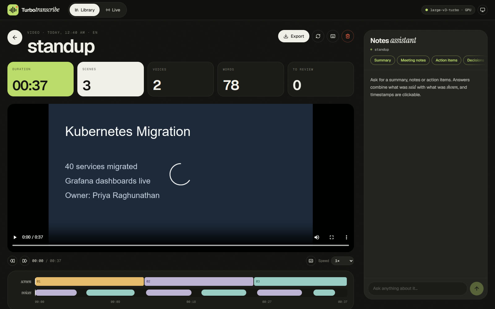

# TurboTranscribe

Local transcription for meetings, lectures and screen recordings that **cross-references what was said with what was shown, and who said it**, so notes and summaries get names, numbers and owners right.



- **Library:** drop audio or video files. Every recording is kept, searchable, playable and editable.
- **Videos are read, not just heard:** slide changes are detected, slide titles and on-screen text are read, and the on-screen vocabulary steers the speech model toward the right spellings. Each sentence is placed on the slide it was spoken over.
- **Who said what:** voices are told apart automatically. Rename "Speaker 2" to "Priya" once, and it changes everywhere.
- **Long classes, mixed languages:** the language is detected across the whole recording (Tagalog and English mixed in one sentence works), Zoom's buttons and participant names are kept out of the notes, and slides are read while the GPU transcribes. A 2.5-hour Zoom class takes minutes, not most of an hour.
- **Live meetings:** capture a browser tab, your microphone, or both (kept apart as **You** and **Others**). Text streams in as people talk, and shared screens are read as they change. When the meeting ends it is saved to the library and re-transcribed at full accuracy, with speakers and slides.
- **Review & fix:** words the model was unsure about are underlined. Where the speech disagrees with the screen ("QBARnet's" vs. **Kubernetes**) a one-click fix is offered. Every line can be edited.
- **Notes assistant:** streaming summaries, meeting notes, action items, decisions or a follow-up email, across one recording or several. It cites clickable timestamps and uses on-screen spellings.
- **Exports:** Markdown, Obsidian notes, plain text, SRT, WebVTT, JSON, and print or PDF.

Speech recognition, OCR and speaker identification all run on your machine. Only the notes assistant (and optional image captions) send text to an external service, OpenRouter. `LOCAL_ONLY=true` turns those off entirely.

## Why cross-reference audio, video and voices?

Real outputs from the test meeting in [docs/PERFORMANCE.md](docs/PERFORMANCE.md):

| | Audio only | Cross-referenced |
| --- | --- | --- |
| A product name | "the **Cubarnet's** migration" | "the **Kubernetes** migration": the slide's vocabulary steers the model; leftovers are flagged for a one-click fix |
| A person's name | "Marcus migrates the cluster" | "**Marcus Okafor** migrates the cluster": the assistant uses the full name from the slide |
| Content nobody said | — | "**ARR impact: 1.2M USD** (on screen)" |
| Who committed | "I will schedule the review" | "**Speaker 2** (renamed: David): I will schedule the review" |

How it works: [docs/VIDEO_PROCESSING.md](docs/VIDEO_PROCESSING.md).

| | |
| --- | --- |
|  |  |
|  |  |

## Requirements

| | Minimum | Recommended (tested) |
| --- | --- | --- |
| Operating system | 64-bit Windows 10 or 11, macOS, or Linux | Windows 11 |
| Processor | 64-bit, 4 cores | 6 or more cores (tested: Intel Core i5-13450HX) |
| Memory | 8 GB RAM | 16 GB or more |
| Graphics | none: everything runs on the CPU, more slowly | NVIDIA GPU with 6 GB of video memory or more and a current driver (tested: RTX 4050 Laptop, 6 GB) |
| Disk space | about 2 GB, plus your recordings | about 6 GB with an NVIDIA GPU, plus your recordings |
| Internet | for the first install and model download | the notes assistant needs it; transcription does not |

Software (installed automatically on Windows; see below): Python 3.10–3.13, Node.js 20 or newer, and ffmpeg. A browser: Edge or Chrome. Firefox works too, except capturing a tab's sound for live meetings.

Details, including what uses the disk space and how fast a 2.5-hour class is processed: [docs/SETUP.md](docs/SETUP.md#requirements).

## Download and start

**1. Get the code.** Either clone the repository:

```bash
git clone <repository-url> TurboTranscribe
cd TurboTranscribe
```

or download it as a ZIP (on GitHub: **Code → Download ZIP**) and extract it to a folder such as `Documents\TurboTranscribe`.

**2. Start it.**

- **Windows:** double-click **`start_app.bat`**. The first time, it installs everything that is missing before starting:
  - Python, Node.js and ffmpeg, through winget, Windows' built-in package manager;
  - the Python and JavaScript packages;
  - the GPU libraries, if you have an NVIDIA GPU.

  This takes 5–15 minutes depending on your connection. Later starts take seconds. You can also run `setup.bat` on its own first.
- **macOS / Linux:** run `./start.sh`. It runs `./setup.sh` when needed, which installs missing tools with Homebrew or apt.

The app opens in your browser. On the very first start, the speech model downloads in the background: about 1.6 GB on an NVIDIA GPU, or about 150 MB for the CPU model. The status pill turns green when it is ready.

**3. Optional: the notes assistant.** Put an OpenRouter key in `backend/.env` (`OPENROUTER_API_KEY=...`) and restart. Everything else works without it.

## Updating

```bash
git pull
```

Then start the app as usual. `start_app.bat` / `start.sh` notice when an update changed the dependency lists (`backend/requirements.txt`, `frontend/package-lock.json`) and install the changes before starting.

With a ZIP download instead, extract the new version over the old folder, or copy these two from the old folder into the new one:

- `backend/.env`, your settings and API key;
- `backend/data/`, your library: recordings, transcripts and edits.

Git never touches these two. They are listed in `.gitignore`, as are the installed packages and downloaded models, which are rebuilt automatically.

## Project layout

```text
ai-transcription-project/
├── backend/                     FastAPI service (Python)
│   ├── main.py                  entry point (`uvicorn main:app`)
│   └── app/
│       ├── main.py              routes, model loading, security middleware
│       ├── pipeline.py          probe → scenes → OCR → glossary → speech → speakers → cross-reference
│       ├── crossref.py          speech ↔ screen alignment, vocabulary, fixes, notes context (pure)
│       ├── transcriber.py       faster-whisper, model auto-selection, hotwords, word confidence
│       ├── diarization.py       speaker identification (sherpa-onnx) + speaker assignment (pure)
│       ├── vision.py            scene detection, duplicate slides, OCR pool, slide titles
│       ├── live.py              live sessions: streaming ASR, two channels, echo removal, saving
│       ├── jobs.py              job queue, library storage, edits, reprocess, cancel, recovery
│       ├── search.py            full-text search over transcripts and slides (SQLite FTS5)
│       ├── media.py · llm.py · config.py · platform_tuning.py
│   └── tests/                   pytest (70 tests)
├── frontend/                    React 19 + Vite + Tailwind 4
│   ├── src/components/          library/, job/, live/, AssistantPanel, TopBar, ui.jsx
│   ├── src/hooks/               useLibrary, useJob, useLiveSession, useMediaTime, …
│   ├── src/lib/                 API client, formats & exports, router, palette
│   └── e2e/                     end-to-end browser test + fixture video
├── docs/                        documentation
├── setup.bat · start_app.bat    Windows
└── setup.sh · start.sh          macOS / Linux
```

## Documentation

| Document | Contents |
| --- | --- |
| [docs/SETUP.md](docs/SETUP.md) | Installation, GPU, configuration reference, troubleshooting |
| [docs/ARCHITECTURE.md](docs/ARCHITECTURE.md) | How the pieces fit together, data model, design decisions |
| [docs/VIDEO_PROCESSING.md](docs/VIDEO_PROCESSING.md) | Audio / video / speaker cross-referencing in depth |
| [docs/DESIGN.md](docs/DESIGN.md) | The visual design system and the references behind it |
| [docs/API.md](docs/API.md) | REST endpoints and the live WebSocket protocol |
| [docs/PERFORMANCE.md](docs/PERFORMANCE.md) | Benchmarks and the optimizations behind them |
| [docs/CHANGELOG.md](docs/CHANGELOG.md) | What changed in each version |
| [docs/ROADMAP.md](docs/ROADMAP.md) | 250 improvement ideas, with what is already done |

## Development

```bash
cd backend  && venv/Scripts/python -m pytest        # 70 backend tests (no models needed)
cd frontend && npm run lint && npm test             # oxlint + 14 unit tests
cd frontend && npm run e2e                          # full browser test against a running app
cd frontend && npm run build                        # production build, served by the backend at /
```
